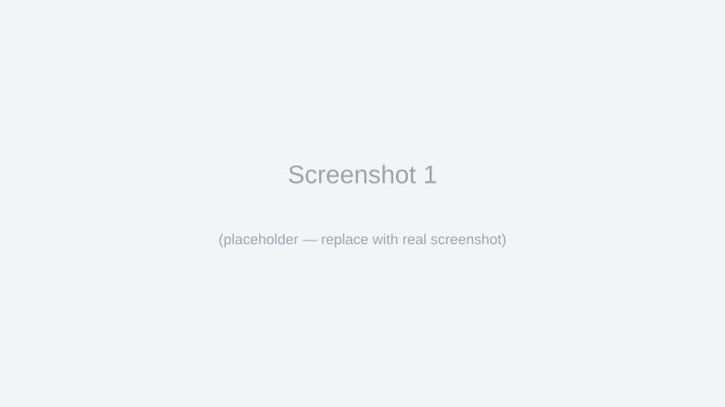
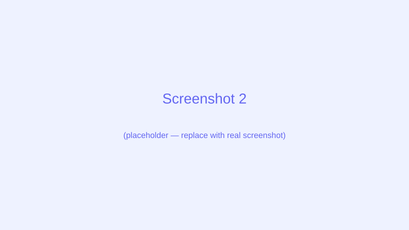

# PicDownloader — Image Saver Browser Extension

A small, configurable browser extension to quickly save images from web pages. PicDownloader lets you download images via a configurable modifier key + mouse button combination, and optionally shows download buttons overlayed on images.

**Key features**

- Quick image saving with a modifier key + click or via on-image download buttons.
- Filename conflict handling: `uniquify` or `overwrite`.
- Filter by minimum image width.
- Options page for configuration (`options/index.html`).
- The information page opens after installation or update and lets users grant download and website access.
- Localization support in the `_locales/` folder.

**Build for Firefox and Chrome**

The source is shared; the build creates separate browser-ready folders:

```bash
npm run build
```

This creates `dist/firefox/` and `dist/chrome/`. To build only one browser:

```bash
npm run build:firefox
npm run build:chrome
```

For Firefox development, run `web-ext` against the generated Firefox build:

```bash
web-ext run --source-dir dist/firefox
```

For Chrome, open `chrome://extensions/`, enable Developer mode, and choose **Load unpacked** → `dist/chrome/`. For Firefox, open `about:debugging` → **This Firefox** → **Load Temporary Add-on**, and select `dist/firefox/manifest.json`.

**Usage**

- Hold the configured modifier key (default: `ctrl`) and click the image with the configured mouse button (default: left) to download quickly.
- If enabled, click the download buttons that appear over images.
- Edit options via the Options page (`options/index.html`).

**Configuration**
Default settings live in `config.js`. Common options:

- `downloadFolder`: Default folder name for saved images (e.g. `mentett_kepek`).
- `minImageWidth`: Minimum image width in pixels to consider for saving.
- `conflictAction`: `uniquify` or `overwrite`.
- `triggerModifier`: Modifier key (`ctrl`, `alt`, etc.).
- `triggerButton`: Mouse button (`left`, `right`, `middle`).
- `showDownloadButtons`: Boolean to enable on-image download buttons.

Configuration reference: [config.js](config.js)

**Localization**
UI strings are in the `_locales/` folder (e.g. `en/messages.json`, `hu/messages.json`). Add a new language by creating a new locale folder with a `messages.json` file.

**Development & Contributing**

- Please open issues or pull requests on the GitHub repository (update the `GITHUB` field in `config.js` with your repo URL).
- Contact email (from `config.js`): vilorisdeveloper@gmail.com

**Screenshots**
Below are example screenshots — replace these placeholders with real captures if you have them.





**Detailed installation (examples)**

- Install `web-ext` globally if you want to run the Firefox development build:

```bash
npm install --global web-ext
```

- Build both browsers:

```bash
npm run build
```

- Run Firefox in development (auto reloads on change):

```bash
web-ext run --source-dir dist/firefox
```

**Examples & usage scenarios**

- Quick save with modifier key:
  1.  Configure `triggerModifier` in `config.js` (default: `ctrl`).
  2.  Configure `triggerButton` (`left` by default).
  3.  Hold `ctrl` and left-click an image to download it to the browser's default download folder (or the configured `downloadFolder`).

- On-image download button:
  1.  Enable `showDownloadButtons` in `config.js` or via the Options page.
  2.  Hover an image to see the download button and click it to save.

**Advanced configuration example**

You can edit `config.js` to change default behaviour. Example snippet:

```js
globalThis.PicDownloaderConfig = {
  DEFAULT_SETTINGS: {
    downloadFolder: "my_saved_images",
    minImageWidth: 150,
    conflictAction: "uniquify",
    triggerModifier: "ctrl",
    triggerButton: "left",
    showDownloadButtons: true,
  },
};
```

**Contributing**

- Fork the repository and open a pull request with your changes.
- Run `npm run build` to generate both browser builds, then test the relevant output folder.
- Update or add screenshots in the `images/` folder and reference them from this README.

**License**

This project is available under the MIT License — see the `LICENSE` file.

---

If you want, I can capture real screenshots from a running instance and insert them into `images/`, or further expand the README with example option values and expected filenames.
